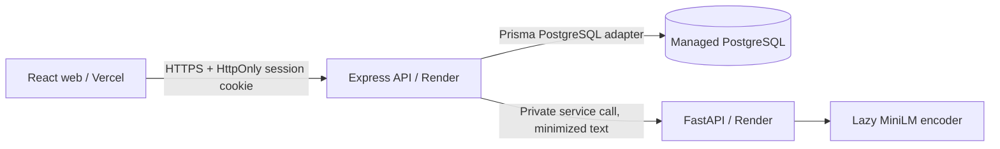
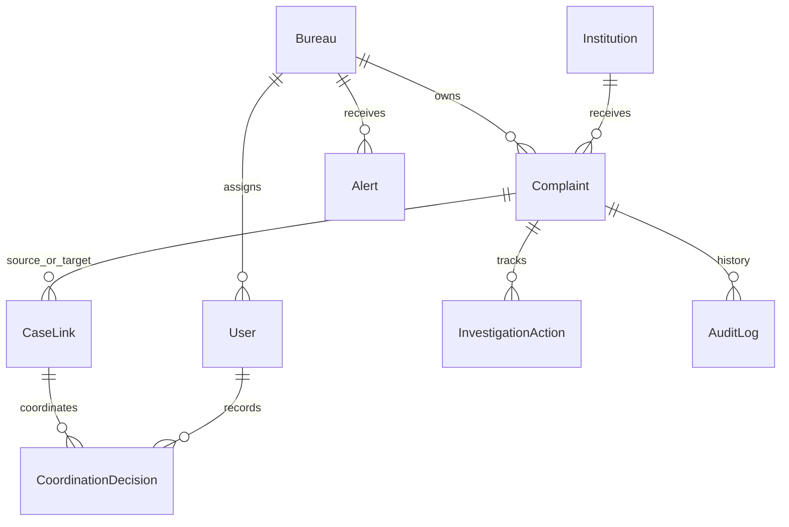

# Architecture

Joel's intelligence/action/coordination routers now implement their contracts and call an authenticated private FastAPI batch-similarity endpoint. Operational/auth issuance routers remain 501 stubs. See [Joel integration notes](JOEL_INTEGRATION.md) for model/rule behavior, transactional concurrency, schema handoff and verification limits.

React Router owns navigation; TanStack Query owns async server state; Axios sends credentialed API calls. `VITE_USE_MOCKS=true` selects a separate typed fixture adapter at build/start time. Errors never silently select mocks. Mock data is public synthetic content, not an authorization mechanism.

Express handles JSON (1 MB limit), configured-origin CORS, cookies, trusted-origin checks for writes and centralized error envelopes. Zod validation is reusable middleware. Prisma Client is generated at install, instantiated lazily, and only connects on database operations; health does not imply database readiness.

Auth is not implemented as login routes yet. Helpers verify HS256 JWTs with issuer/audience and expiry, reload the active user from DB, and check roles. Session cookies use HttpOnly, eight-hour expiry, SameSite=Lax by default and Secure in production. JWT signing must use the same issuer/audience/expiry. Password helpers enforce bcrypt's 72-byte limit and use cost 12. Add login rate limiting, session invalidation strategy and auth integration tests before exposing real accounts.

Every non-admin resource query must apply bureau scope, including counts, nested relations, exports, timelines and graphs. Nonexistent and inaccessible IDs should both return 404. Cross-bureau link summaries are redacted: reveal only explicitly permitted relationship metadata, never other bureaus' descriptions or evidence by default. Confirmed links do not grant general access. A future explicit sharing policy can expand access after team agreement.

API modules own business services, repository queries and authorization; shared middleware should stay generic. AI code owns vector generation/comparison, not access policy or regulatory decisions. Pass minimal texts to AI with no private contact details. Run the AI behind private networking/service authentication before adding inference routes.

Production: prefer frontend/API under the same site. With Vercel and Render on unrelated default domains, set `COOKIE_SAME_SITE=none` with production HTTPS and preserve exact trusted Origin validation; browsers may restrict third-party cookies, so custom same-site domains are preferable. Secrets live in provider settings, never Vite variables. Run `db:deploy` as a release step, not on every request. Supply PostgreSQL SSL settings from the provider; never disable certificate validation globally.

Setup conventions consulted: [Vite](https://vite.dev/guide/), [Tailwind Vite plugin](https://tailwindcss.com/docs/installation/using-vite), [shadcn Vite](https://ui.shadcn.com/docs/installation/vite), [Prisma 7 client generation](https://www.prisma.io/docs/orm/v7/prisma-client/setup-and-configuration/generating-prisma-client), [Sentence Transformers](https://sbert.net/docs/installation.html). Prisma 7 is deliberately pinned as a supported major; generated source and pg adapter follow its ESM setup.
